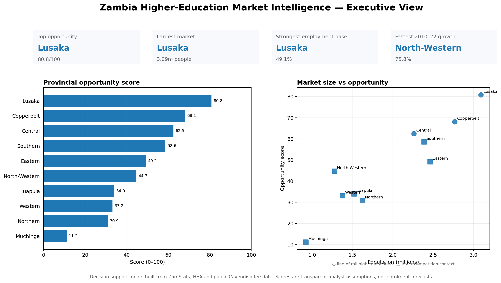
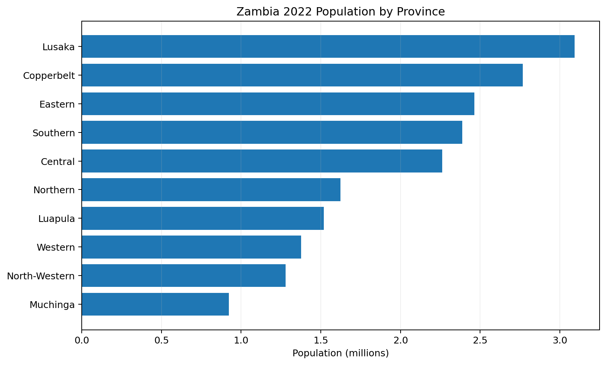
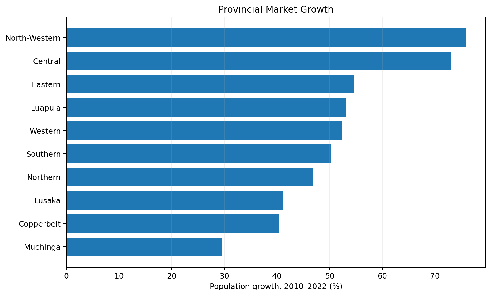
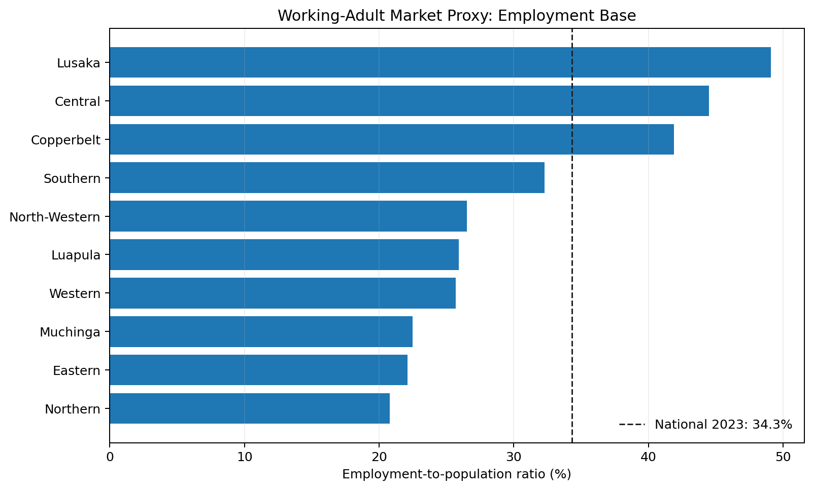
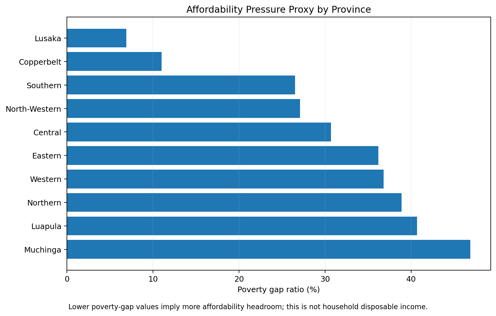
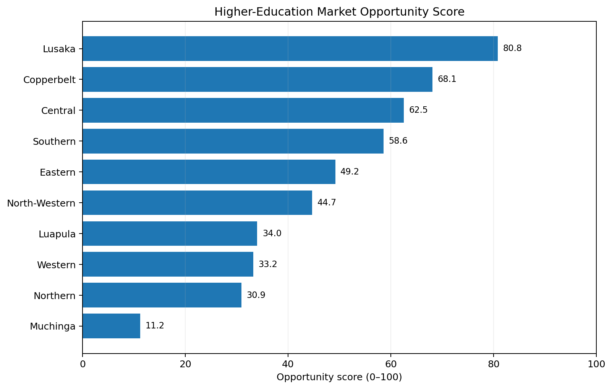
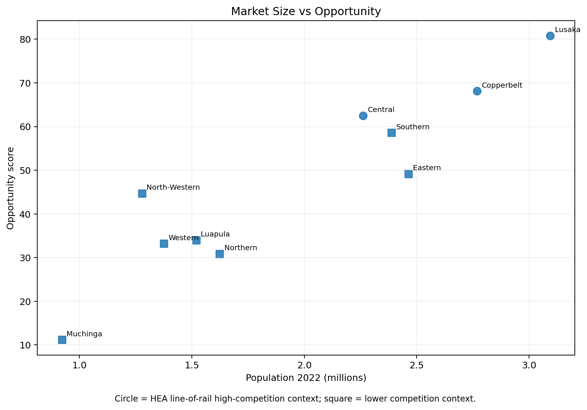
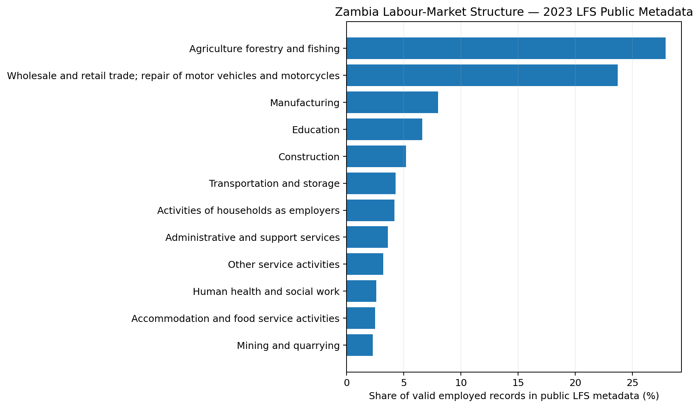
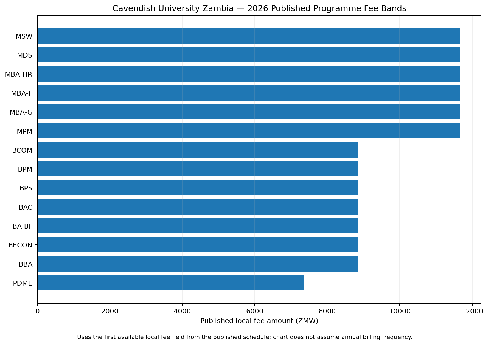
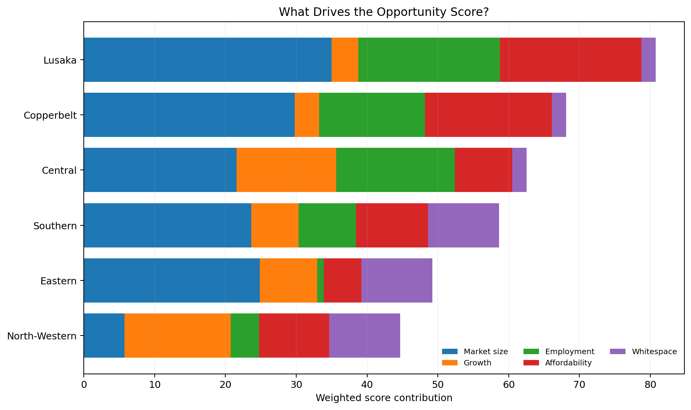

# Zambia Higher-Education Market Intelligence & Enrolment Growth Analytics

A **Business Analyst portfolio project** that turns official Zambian demographic, labour-market, poverty, higher-education and public tuition data into an actionable market-growth decision system for a private university.

> **Business question:** Where should a university focus recruitment, which markets deserve investment, and where should management use a lower-cost distance-led strategy rather than expensive physical expansion?

This is not a demo student database and it does **not** use confidential Cavendish University data. The analysis uses real public Zambia data and makes every modelling assumption visible and editable.



## Business value

The project supports five management decisions:

1. **Recruitment territory prioritisation** — compare Zambia's ten provinces using market size, growth, employment, affordability pressure and competitive whitespace.
2. **Working-adult targeting** — use provincial employment-to-population ratios as a practical indicator of employed learner segments.
3. **Affordability strategy** — identify markets where tuition conversion may be constrained by poverty pressure and where flexible payment, sponsorship or distance delivery may matter more.
4. **Competitive strategy** — incorporate HEA evidence that universities are heavily concentrated along the Lusaka–Copperbelt–Central line of rail.
5. **Campaign scenario modelling** — let management change recruitment spend and conversion assumptions in Excel and see registrations, acquisition cost and fee-value coverage.

## Executive findings from the current model

The transparent weighted model ranks **Lusaka (80.8)**, **Copperbelt (68.1)** and **Central (62.5)** highest. This does **not** mean "open a campus there". It means these provinces warrant the first management review because their combined population, growth, employment and affordability indicators are strongest under the stated weights.

- **Lusaka** combines Zambia's largest provincial population, the highest 2023 employment-to-population ratio and the lowest 2022 poverty-gap value in this model. The trade-off is intense higher-education competition.
- **Copperbelt** has the second-largest population and a strong employment base, again with high competitive intensity.
- **Central** scores strongly because of rapid population growth and a high employment ratio despite greater affordability pressure than Lusaka or Copperbelt.
- **Southern** appears as a useful selective-growth market: large population, lower competitive concentration than the line-of-rail core and moderate affordability/employment indicators.
- **North-Western** has the fastest population growth in the dataset but a smaller population base; the model therefore treats it as a candidate for lower-cost digital/distance acquisition tests before physical investment.

These are **decision hypotheses** to validate with real admissions, enquiry, conversion, student residence and campaign data when available.

## Visual analysis

### 1. Provincial market size


### 2. Market growth


### 3. Working-adult market proxy


### 4. Affordability pressure


### 5. Opportunity score


### 6. Market size vs opportunity


### 7. Zambia labour-market structure


### 8. Cavendish public programme fee bands


### 9. What drives the score


## Opportunity model

The score is deliberately simple and auditable:

| Component | Weight | Rationale |
|---|---:|---|
| Market size | 35% | Larger provinces provide a larger addressable market |
| Population growth | 15% | Growth indicates an expanding future market |
| Employment base | 20% | Supports the working-adult/professional segment |
| Affordability headroom | 20% | Lower poverty gap is treated as more pricing headroom |
| Competitive whitespace | 10% | HEA reports strong university concentration along the line of rail |

All metrics are min-max normalised to a common scale before weighting. The competition component is an **ordinal proxy**, not a count of private competitors by province.

Rebuild the model:

```bash
pip install -r requirements.txt
python analysis/build_market_intelligence.py
python analysis/build_executive_dashboard.py
```

## Excel scenario model

`excel/University_Recruitment_Scenario_Model.xlsx` demonstrates the Excel side of the Business Analyst role.

Management can change:

- target province;
- campaign budget;
- cost per lead;
- lead-to-application conversion;
- application-to-registration conversion; and
- published fee value per registration.

The workbook calculates estimated leads, applications, registrations, marketing cost per registration and gross published fee-value coverage. The default conversion rates are **scenario assumptions**, not Cavendish historical performance.

## Business analysis deliverables

The repository goes beyond visualisation:

- `business_analysis/Business_Requirements_Document.md` — problem statement, scope, users and requirements.
- `business_analysis/KPI_Data_Dictionary.md` — controlled KPI definitions.
- `business_analysis/Stakeholder_Matrix.md` — decision owners and information needs.
- `business_analysis/Requirements_Traceability_Matrix.md` — maps business needs to outputs.
- `business_analysis/UAT_Test_Cases.md` — test cases for management acceptance.
- `business_analysis/AS_IS_TO_BE_Process.md` — process-improvement case.
- `sql/market_intelligence.sql` — relational model and decision queries.
- `notebooks/Zambia_Market_Intelligence.ipynb` — reproducible analytical walkthrough.
- `dashboard/index.html` — lightweight executive gallery for local viewing.

## Data architecture

```text
ZamStats Census ─────────────┐
ZamStats Labour Force ───────┤
ZamStats LCMS ───────────────┤
HEA higher-education data ───┼──> governed analytical layer
Cavendish public fees ───────┘              │
                                            ├── Python analysis
                                            ├── SQL decision queries
                                            ├── Excel scenario model
                                            └── executive visualisations
```

## Data sources

All project source URLs are also recorded in `data/raw/source_register.csv`.

- **Zambia Statistics Agency — 2022 Census National Analytical Report:** https://www.zamstats.gov.zm/wp-content/uploads/2025/08/2022-Census-National-Analytical-Report.pdf
- **Zambia Statistics Agency / Ministry of Labour — 2023 Labour Force Survey:** https://www.zamstats.gov.zm/wp-content/uploads/2024/11/2023-Labour-Force-Survey-Report.pdf
- **Zambia Statistics Agency — 2022 Living Conditions Monitoring Survey:** https://www.zamstats.gov.zm/wp-content/uploads/2024/07/2022-LCMS-Report-2022.pdf
- **Higher Education Authority — State of Higher Education in Zambia 2023:** https://hea.org.zm/download/the-state-of-higher-education-in-zambia-2023/
- **Cavendish University Zambia — 2026 Tuition Fee Schedule:** https://www.cavendishza.org/tuition-fee-schedule/

## Important analytical limitations

- The opportunity index is **decision support, not a forecast of enrolments**.
- Poverty gap is an affordability-pressure proxy; it is not household disposable income.
- HEA competition is represented as an ordinal line-of-rail context because the current model does not claim exact private-competitor counts per province.
- The public LFS industry and occupation metadata tables included here describe the distribution of valid public microdata records; they should not be treated as survey-weighted population estimates without applying survey weights.
- Cavendish fee values are taken from the published 2026 schedule. The project does not assume a billing frequency beyond what the public page explicitly states.
- A production version should add actual university enquiry, application, registration, fee-collection, programme-capacity and campaign data.

## How this demonstrates Business Analyst capability

This project shows the complete BA chain: **business problem → source assessment → requirements → data model → SQL/Python analysis → KPI definitions → management visualisation → scenario modelling → process improvement → UAT → decision recommendation**.

That is the intended portfolio story: not "I can make charts", but **"I can structure ambiguous business questions, integrate data, define governed metrics and turn analysis into management action."**
